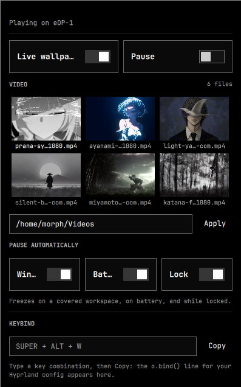

# Livewall

Live video wallpapers on Hyprland with per-monitor control and automatic pause.



## Features

- **Live wallpapers** via mpvpaper on the bottom layer, visible above stock Omarchy backgrounds
- **Per-monitor control**: each display can show its own video, switch between Live and Stock independently, and be paused on its own
- **Same on all monitors** switch for users who want one wallpaper everywhere
- **Hotplug safe**: adding or removing a display never leaves an orphan mpvpaper; settings are kept per output name and restored when it comes back
- **Video grid** with thumbnails (generated via ffmpeg, cached once and shared by all monitors)
- **Manual pause/resume** per monitor, plus quick pause-all via right-click on the bar icon
- **Auto-pause**: a fullscreen/tiled window pauses only its own monitor; battery and lock pause everything
- **Folder selection** with support for nested directories (up to 3 levels)
- **Keybinding helper** with copy-to-clipboard for Hyprland config

## Dependencies

- `ffmpeg` — video thumbnail generation (official Arch repositories)
- `mpvpaper` — live wallpaper renderer (AUR package `mpvpaper`)

Install both with the package manager and AUR helper you normally use. The
plugin never asks for root: it starts `mpvpaper` and `ffmpeg` as your user and
nothing else.

## Installation

```bash
omarchy plugin add https://github.com/drwxfinch/omarchy-livewallpaper.git
omarchy plugin enable morph.livewall --section right
```

## Usage

Click the bar icon or press the keybinding to open the panel. Select a video, toggle Live mode, adjust auto-pause rules.

With more than one monitor the panel shows a picker at the top: each chip lists the output name, resolution and live state (Playing / Paused / Stock). The video grid, Live switch and Pause switch then apply to the selected output. Turn on **Same on all monitors** to edit one shared setting for every display again.

**Pause all monitors / Resume all monitors** is next to the per-monitor switches. Right-clicking the bar icon does the same without opening the panel: it pauses every monitor when at least one is playing, and resumes every monitor otherwise.

### Command line

```bash
# JSON with a monitors[] array, one entry per connected output
omarchy-shell morph.livewall status

# Pause or resume one monitor (empty argument = every monitor)
omarchy-shell morph.livewall pause DP-1
omarchy-shell morph.livewall resume DP-1
omarchy-shell morph.livewall pause
```

### Keybinding

The panel displays a ready-to-use `o.bind(...)` line. Copy it and paste into your `~/.config/hypr/bindings.lua`:

```lua
o.bind("SUPER + ALT + W", "Livewall", "omarchy-shell shell toggle morph.livewall")
```

The plugin **does not edit your Hyprland config** — you paste the line manually.

## Settings

Settings are stored in `~/.config/omarchy/shell.json` and survive restarts.

Global keys:

- `folder`: video folder (default `~/Videos`)
- `autoWindows`, `autoBattery`, `autoLock`: auto-pause toggles

Default keys, used when sync is on and as fallback values for per-monitor entries:

- `video`: default video path
- `mode`: `"live"` or `"static"`
- `paused`: default manual pause state

Multi-monitor keys:

- `syncMonitors`: `true` (default) uses the default keys for every display; `false` enables per-monitor settings
- `monitors`: map keyed by output name, for example:

```json
{
  "syncMonitors": false,
  "video": "~/Videos/default.mp4",
  "mode": "live",
  "paused": false,
  "monitors": {
    "eDP-1": { "video": "~/Videos/laptop.mp4", "mode": "live", "paused": true },
    "DP-1":  { "video": "~/Videos/desktop.mp4", "mode": "static" }
  }
}
```

Resolution order for one output:

1. `syncMonitors: true` — the default `video` / `mode` / `paused` values;
2. `syncMonitors: false` — `monitors[name]`, with any missing field taken from the default values;
3. no entry for that output — the default values.

Configs written before multi-monitor support (only `video`, `mode`, `paused`) keep working unchanged: with no `syncMonitors` key the plugin behaves as if it were `true`, so every display shows the same wallpaper. No manual migration is needed.

Disconnected monitors keep their `monitors[name]` entry, so reconnecting an output restores its video and pause state. The panel offers **Forget disconnected monitor** to drop those entries explicitly.

## Performance

Every monitor that is playing Live runs its own mpv decoder, so two or three live wallpapers mean two or three decoders and noticeably more GPU/CPU load. To keep the cost down:

- use the same video file on all monitors (the decoder still runs per output, but the file stays in the page cache);
- switch monitors you are not looking at to Stock — mpvpaper is fully stopped in that mode;
- pause the wallpapers when running on battery (`autoBattery`).

## Privacy

Opening the panel lists the video folder and generates a thumbnail for every
listed video, not only for the one currently used as wallpaper (up to 120 files,
nested three levels deep). Those frames are cached in
`~/.cache/morph.livewall/thumbs` and are **not** deleted when a video is removed
from the folder; clear that directory to drop them.

The cache is created with mode `0700` and its thumbnails with `0600`, so another
local account cannot read frames decoded from a `0600` video or a `0700` folder
even when the login umask is `022`. Existing caches are tightened on the next
panel open. The plugin does not rely on `$HOME` being `0700`.

## Security notes

The plugin runs entirely as your user and requests no privileges:

- it starts `mpvpaper` (one process per live monitor) and `ffmpeg` (thumbnail
  generation) — no other programs, and no shell built from video names;
- it reads only the video folder you configure and writes only
  `~/.cache/morph.livewall/thumbs`;
- it does not download anything, has no network access of its own, and never
  edits your Hyprland config (the keybinding line is copied to the clipboard
  for you to paste).

## Limitations

- **Widget coupling**: removing the widget from the bar disables the service (host semantics; re-add the widget to re-enable)
- **Stock wallpaper**: changing Omarchy's background while in Live mode works, but mpvpaper stays on top
- **Mixed scale**: multi-monitor was tested with 1366×768 and 1920×1080 at scale 1; unusual scale/rotation combinations are not covered by automated tests

## License

MIT
